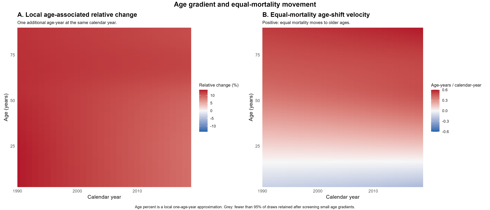
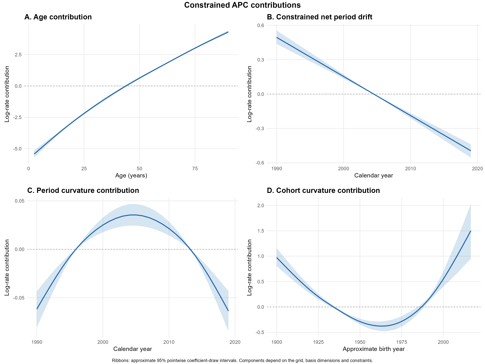
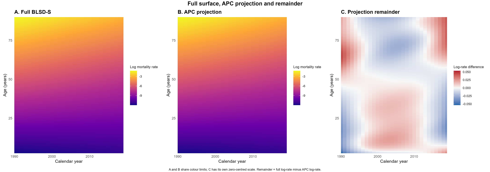

# 模拟示例图表

以下图表由原微信示例的模拟数据生成（seed 123，1990—2019 年，540 个年龄—年份观测），采用 1,000 次相关系数抽样。每张图都有 PNG 和 PDF。数值核验记录见 [验证说明](../docs/validation.md)，完整目录见 [图表清单](figure_manifest.csv)。

## 年龄百分比与年龄移动速度

左侧为年龄梯度逐抽样转换得到的局部相对变化百分比；右侧为等死亡率年龄移动速度，单位为岁／日历年。

## APC 贡献曲线

曲线和区间是在明确基维度、网格及约束下得到的结构摘要。

## 完整曲面、APC 部分与剩余面

其余图表包括死亡率曲面、年度变化百分比、时间加速度、队列视角的计数残差、年龄截面、各年龄时间趋势、区间方向分类、计数拟合诊断、六项 APC 分量及剩余死亡率乘数。
